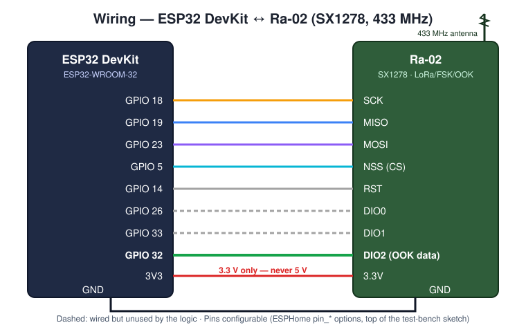
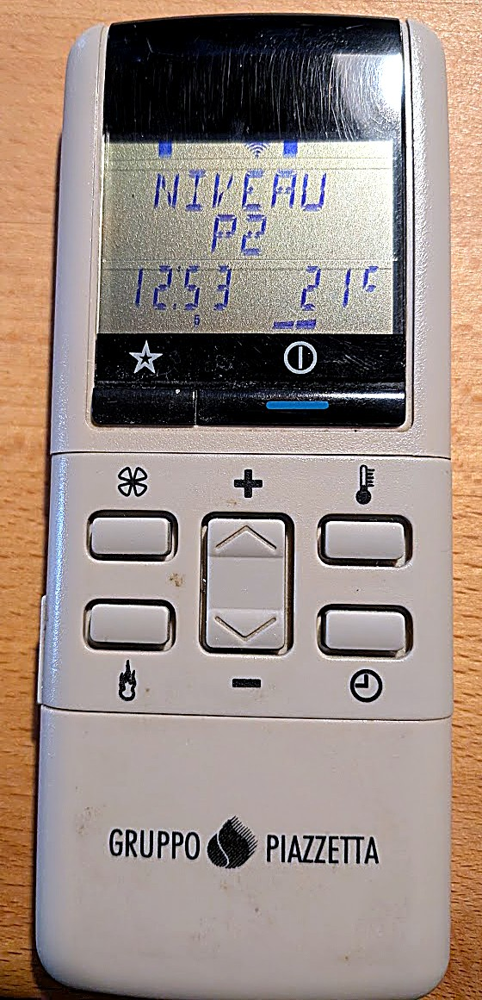

# Hardware

## Parts

| Part | Reference used | Notes |
| --- | --- | --- |
| Microcontroller | **ESP32 DevKit** (ESP32-WROOM-32, CP210x USB) | the classic dual-core ESP32. ESPHome board `esp32dev`, Arduino board "ESP32 Dev Module" |
| Radio | **Ra-02** (AI-Thinker, Semtech **SX1278**, 433 MHz), marked "LoRa/FSK/OOK" | OOK support is mandatory |
| Antenna | 433 MHz antenna on the Ra-02 IPEX/U.FL connector, or a 17.3 cm wire (¼ wave) | check it really is a **433 MHz** antenna (some listings say "2.4G" by mistake) |
| Power | any USB charger (5 V, ≥ 500 mA) | permanent supply. **The USB cable matters**: one cable cost ≈ 20 dB of 433 MHz reception (stove read at −75 dBm instead of −55, frames rejected), while Wi-Fi was fine. Prefer a short, good-quality cable, ideally with a ferrite, and check the "radio signal" sensor after any change |

### Identifying the parts

* ESP32 DevKit: Espressif's reference board family — [ESP32-DevKitC user guide](https://docs.espressif.com/projects/esp-dev-kits/en/latest/esp32/esp32-devkitc/index.html). Most "ESP32 DevKit V1" clones (30 or 38 pins, CP210x or CH340 USB chip) work the same.
* Ra-02: a small shielded module by AI-Thinker carrying a Semtech **SX1278** — [SX1278 product page](https://www.semtech.com/products/wireless-rf/lora-connect/sx1278). The shield is usually marked "Ra-02 … LoRa/FSK/OOK"; it has a U.FL/IPEX antenna connector and 2 mm-pitch pads (a small adapter board or careful soldering is needed).

### Radios that do **not** work

* **Heltec WiFi LoRa 32 V3** (SX1262): the SX1262 only demodulates LoRa and (G)FSK, **not OOK**.
* Cheap superheterodyne receivers (RXB6…) could receive but cannot transmit; a CC1101 module would probably work (OOK RX/TX) but is untested here — the component uses RadioLib's SX1278 driver.

## Wiring (ESP32 VSPI)

| Ra-02 pin | ESP32 GPIO | Role |
| --- | --- | --- |
| SCK | 18 | SPI clock |
| MISO | 19 | SPI data in |
| MOSI | 23 | SPI data out |
| NSS (CS) | 5 | SPI chip select |
| RST | 14 | reset |
| DIO0 | 26 | (interrupt, unused by the logic) |
| DIO1 | 33 | (data clock in continuous mode, unused) |
| **DIO2** | **32** | **OOK data**: output of the demodulator in receive mode, **input** of the modulator in transmit mode |
| 3.3V | 3V3 | **3.3 V only — never 5 V** |
| GND | GND | the four GND pads of the Ra-02 are connected together; one is enough |

All pins are configurable in the ESPHome YAML (`pin_*` options) and at the top of the test-bench sketch. Avoid strapping pins 0, 2, 12, 15 for RST and DIO lines.

Before the first power-up: with a multimeter in continuity mode, all GND pads must beep together, and **3.3V must not beep with GND** (solder bridge = short circuit).

## Placement

* The reference installation receives the stove at **−55 to −65 dBm** a few metres away; the receiver threshold is −78 dBm. Keep a margin of 10 dB or more: if the "stove reachable" sensor flaps, move the module closer to the stove.
* Moving the module also changes Wi-Fi: watch both signal sensors after moving it.
* **Never transmit without an antenna** (risk of damaging the SX1278 output stage).
* Transmit power 10 dBm was enough on the reference installation (17 dBm max).

## Photos

The remote — keys: fan (✻, top left), + / −, thermometer (top right), flame (power, bottom left), clock (bottom right); soft keys ★ and ⏻ under the screen.
